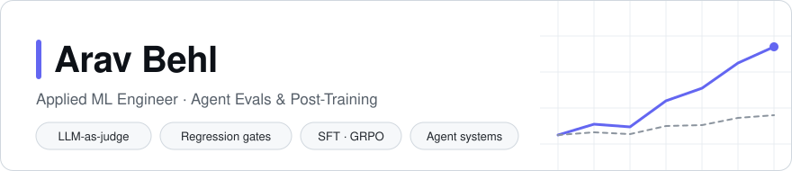
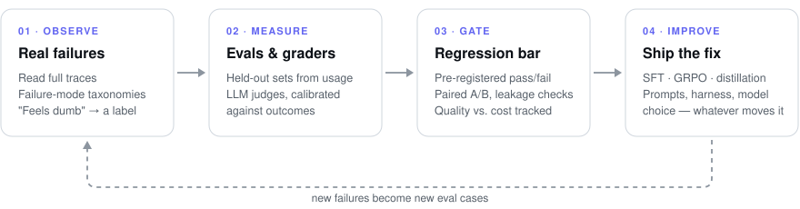

  

  
  
  
  

I make LLM agents measurably better. I turn real failures into eval sets, build graders and regression gates a team can trust, and ship the post-training, prompt, or model changes that move the number.

- **Now:** I lead evals and post-training (SFT, GRPO) for long-horizon tool-use agents at a stealth AI startup.
- **Before:** Global Macro at **Point72** (London) · production agent evals at **UnifyApps** · AI research at **NTU / NIE**.
- **Background:** B.Sc. Data Science & Economics (Distinction), NTU, as a President Research Scholar.

### How I work

  

### Selected work

| Project | What it shows |
| --- | --- |
| [**PaperShield**](https://github.com/arav-behl/ai_safety) | Prompt-injection eval: attack success went from **0% → 19.4%**. A defense cut harmful outputs but blocked **72%** of safe queries, so the safety/usability trade-off is quantified. |
| [**ML for Indian equity portfolios**](https://github.com/arav-behl/Quant_Research_Strategies) | 16 strategies (Ridge, LSTM, PPO, LLM-based vs. Black-Litterman) across 50 Nifty stocks and 289 features, including FinBERT sentiment. |
| [**Crypto order book engine**](https://github.com/arav-behl/rust_new) | Limit order book in Rust with price-time matching and live Binance WebSocket data. |
| [**C++ real-time market data**](https://github.com/arav-behl/cpp_project) | Low-latency market data handler in C++20. |
| [**Transcript clustering**](https://github.com/arav-behl/clustering_project) | Hierarchical NLP clustering of multi-customer discovery meetings. |
| [**Pulsefield**](https://github.com/arav-behl/pulsefield) | Local-first Apple Health analytics. Every metric traces back to its source data, units, and versioned algorithm. |

### Toolkit

**Evals:** LLM-as-judge · held-out & regression gates · failure taxonomies · paired A/B · cost tracking 
**Training:** SFT · GRPO · LoRA · distillation · PyTorch · Transformers · vLLM · W&B 
**Engineering:** Python · TypeScript · SQL · Rust · C++ · GCP · AWS · Docker · Postgres · Next.js
