<!-- Cards are animated SVGs drawn by scripts/render.py and refreshed daily by
     .github/workflows/update-cards.yml. Spacing is baked into the SVGs, so keep this block
     free of blank lines and keep each row of repo cards on one line with no spaces between them. -->

 
 
 
 
 

<a href="https://aravbehl.com">aravbehl.com</a> &nbsp;/&nbsp; <a href="https://www.linkedin.com/in/arav-behl-0524a6230/">linkedin</a> &nbsp;/&nbsp; <a href="https://twitter.com/AravBehl">x</a>

